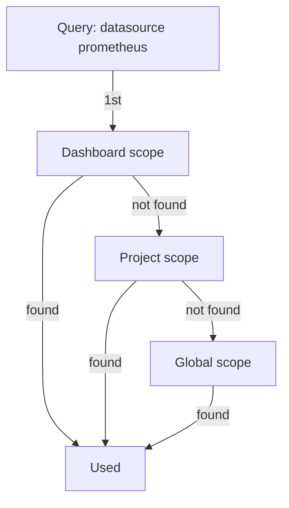

# Projects, Resources And Scopes

An empty Perses server cannot show anything. Before the first dashboard, it needs a place to keep it and a way to reach the data. This part creates both with `percli`: a project, then a datasource inside it. Along the way it names every kind of resource Perses stores, and explains the scopes that decide which datasource a dashboard really uses.

## The project comes first

A **project** is the resource that groups everything one team works on: dashboards, datasources, variables, secrets, folders, roles and role bindings. Every dashboard must belong to a project. A project needs nothing but a name.

<!-- astrona:playground:renew -->

Save this as `project-inventory.yaml`:

```yaml
kind: Project
metadata:
  name: inventory
spec: {}
```

Apply it:

```sh
percli apply -f project-inventory.yaml
```

Then check the result:

```sh
percli get project
```

`percli apply` reads the file and sends it to the Perses REST API, which stores the project. `percli` confirms that the object `Project` `inventory` has been applied, and the project list now shows `inventory` with its age. Running `percli apply` again with the same file updates the project instead of failing: apply creates a resource that does not exist and updates one that does.

Most `percli` commands work inside one project, so select it once:

```sh
percli project inventory
```

`percli` stores the selected project next to the server URL in `~/.perses/config.json`. From now on, `percli get dashboards` means the dashboards of `inventory`. You can still name another project for one command with `--project` (or `-p`).

## A datasource for Prometheus

A **datasource** is a resource that holds the settings to reach one data backend. Its `spec.plugin.kind` says which datasource plugin it uses, and `spec.plugin.spec` holds that plugin's own settings. For Prometheus, the plugin is `PrometheusDatasource`.

Save this as `datasource-prometheus.yaml`:

```yaml
kind: Datasource
metadata:
  name: prometheus
  project: inventory
spec:
  default: true
  plugin:
    kind: PrometheusDatasource
    spec:
      proxy:
        kind: HTTPProxy
        spec:
          url: http://prometheus.observability:9090
```

Apply it:

```sh
percli apply -f datasource-prometheus.yaml
```

Then check the result:

```sh
percli get datasources
percli describe datasource prometheus
```

The list shows `prometheus` in the project `inventory`. `percli describe` prints the full resource as YAML, including the `createdAt` and `updatedAt` times the server added to `metadata`. The two fields to look at are the `proxy` block and `default: true`.

The `proxy` block with the kind `HTTPProxy` tells Perses to forward queries itself. The browser never contacts Prometheus: it sends the query to Perses, and Perses sends it on to the URL in the datasource. That is why the URL is the in-cluster address `http://prometheus.observability:9090`, which your browser could never reach. The flag `default: true` makes this datasource the one a panel uses when its query names no datasource of the kind `PrometheusDatasource`.

## Every kind of resource

A project and a datasource are two of about a dozen resource kinds. They fall into two groups: resources that live inside one project, and global resources that the whole server shares.

| Inside a project | Global form | What it holds |
| --- | --- | --- |
| `Dashboard` | (none) | Panels, their queries, the layout and variables |
| `Datasource` | `GlobalDatasource` | Settings to reach a data backend |
| `Variable` | `GlobalVariable` | A value that queries can use, such as a list of `job` names |
| `Secret` | `GlobalSecret` | Credentials a datasource needs; never returned in clear text |
| `Folder` | (none) | A tree to organise the dashboards of a project |
| `Role`, `RoleBinding` | `GlobalRole`, `GlobalRoleBinding` | Permissions, and which users get them |
| (none) | `User` | An account that can log in |
| (none) | `Project` | The container for everything in the first column |

A project resource carries its project in `metadata.project`, as the datasource above does. A global resource has no project at all.

## Three scopes for one name

A datasource can be defined at three scopes, and the same name may exist at all three. A **global** datasource (`GlobalDatasource`) is available to every dashboard on the server. A **project** datasource (`Datasource`) is available to every dashboard in its project. A **dashboard** datasource lives inside one dashboard's own `spec.datasources` and only that dashboard can use it.

When a query names a datasource, Perses looks for the name at the smallest scope first:



The diagram shows the lookup order: the dashboard's own datasources, then the project's, then the global ones; the first match wins.

This lets a team override a shared definition on purpose: a global `prometheus` for everyone, a project `prometheus` that points somewhere else for one team, and a dashboard-scoped one for a single special case. It also means a forgotten override at a smaller scope silently wins over the one you just fixed. Variables follow the same three scopes and the same rule.

To see the global scope, create a global datasource with the same name. Save this as `globaldatasource-prometheus.yaml`:

```yaml
kind: GlobalDatasource
metadata:
  name: prometheus
spec:
  default: true
  plugin:
    kind: PrometheusDatasource
    spec:
      proxy:
        kind: HTTPProxy
        spec:
          url: http://prometheus.observability:9090
```

Apply it:

```sh
percli apply -f globaldatasource-prometheus.yaml
```

Then check the result:

```sh
percli get globaldatasources
```

Now `prometheus` exists twice: once globally and once in `inventory`. A dashboard in `inventory` that names `prometheus` uses the project datasource. A dashboard in any other project uses the global one.

You now have a project, a project datasource and a global datasource, and you know which one a dashboard in `inventory` would pick. What is still missing is the dashboard itself, and proof that a query really reaches Prometheus.

## Common pitfalls

> [!WARNING]
> - **Leaving out `metadata.project`.** A `Datasource` without a project is not a global datasource. Global ones use the kind `GlobalDatasource`.
> - **Using a URL only your machine can reach.** With the `HTTPProxy`, Perses sends the query, so the URL must work from inside the cluster, not from your browser.
> - **Forgetting which project `percli` has selected.** `percli get dashboards` shows the selected project only. Run `percli project` to see which one that is.
> - **Fixing the wrong scope.** If a smaller scope defines the same name, fixing the global datasource changes nothing for that dashboard.
