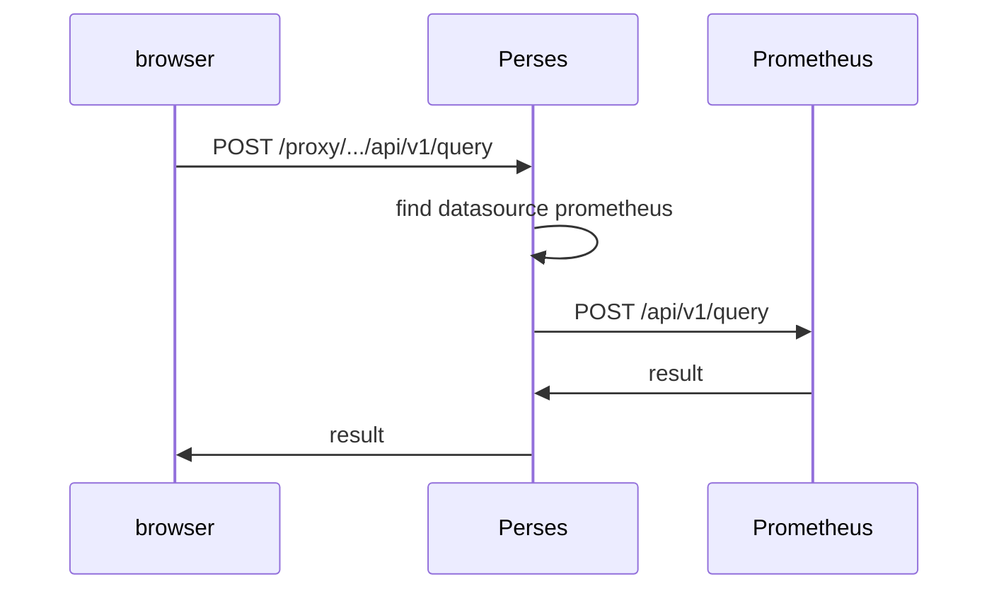

# A First Dashboard And The Datasource Proxy

A dashboard is the resource people actually look at, and it is also the one with the most links to other resources. Each panel holds queries, each query names a datasource, and a layout places the panels on the page. When a panel is empty, one of these links is broken. This part builds a small dashboard, takes it apart, and follows its query through the Perses datasource proxy to Prometheus, so you can test each link on its own.

## The parts of a dashboard

A dashboard has a `spec` with a few main fields. `panels` is a map from a panel key to a panel definition. `layouts` is a list of grids that place the panels; a layout does not copy a panel, it points at one with a JSON reference such as `#/spec/panels/upTargets`. `duration` is the default time range, and `display.name` is the title people see.

Each panel has a `plugin`, the panel type such as `TimeSeriesChart`, and a list of `queries`. Each query has its own plugin, here `PrometheusTimeSeriesQuery`, with the PromQL text in `query` and the datasource it should use in `datasource`. The datasource reference holds the datasource plugin kind and a name.

<!-- astrona:playground:renew -->

The commands below need the project `inventory` with the datasource `prometheus` from the previous steps of this module. If you started a fresh playground, apply both files again first.

Save this as `dashboard-scrape-health.yaml`:

```yaml
kind: Dashboard
metadata:
  name: scrape-health
  project: inventory
spec:
  display:
    name: Scrape health
  duration: 1h
  panels:
    upTargets:
      kind: Panel
      spec:
        display:
          name: Scrape targets up
        plugin:
          kind: TimeSeriesChart
          spec: {}
        queries:
          - kind: TimeSeriesQuery
            spec:
              plugin:
                kind: PrometheusTimeSeriesQuery
                spec:
                  query: up
                  datasource:
                    kind: PrometheusDatasource
                    name: prometheus
  layouts:
    - kind: Grid
      spec:
        items:
          - x: 0
            y: 0
            width: 12
            height: 6
            content:
              $ref: "#/spec/panels/upTargets"
```

Apply it:

```sh
percli apply -f dashboard-scrape-health.yaml
```

Then check the result:

```sh
percli get dashboards
```

The list shows `scrape-health` in `inventory`. Open `http://perses.localtest.me:8080` in your browser, go to the project `inventory` and open the dashboard: one panel draws a line at the value `1` for the Prometheus target.

## What the server checked, and what it did not

When you applied the dashboard, the Perses server checked it against the CUE schemas of the plugins it names: `TimeSeriesChart` must have a valid panel spec, and `PrometheusTimeSeriesQuery` must have a `query`. A misspelled plugin kind or a wrong field type is refused at this step.

The name in the datasource reference is different. To the schema it is just a string, so the server does not refuse a dashboard that names a datasource that does not exist. The problem appears only when the panel runs its query and Perses cannot find a datasource with that name at any scope. So a dashboard that applied cleanly can still show an empty panel, and the next step is to test the query path on its own.

## Following a query through the proxy

When the browser draws the panel, it does not send the query to Prometheus. It sends it to the Perses datasource proxy, at a path that names the scope and the datasource:



The diagram shows Perses looking up the datasource, forwarding the request to the URL stored in it, and returning the answer unchanged.

The proxy path for a project datasource is `/proxy/projects/<project>/datasources/<name>/`, followed by the path of the backend's own API. For a global datasource it is `/proxy/globaldatasources/<name>/`. You can call it yourself. Send the same query the panel sends, through the project datasource:

```sh
curl -s -X POST --data-urlencode 'query=up' \
  http://perses.localtest.me:8080/proxy/projects/inventory/datasources/prometheus/api/v1/query \
  | jq '{status: .status, series: (.data.result | length)}'
```

The answer comes from Prometheus, passed through by Perses: `status` is `success` and `series` is at least `1`. This one command tests the datasource on its own, without the dashboard. If it fails, the datasource is wrong; if it works but the panel stays empty, look at the dashboard's query and its datasource reference.

To see the failing case, point the datasource at a port where nothing listens. Edit `datasource-prometheus.yaml`, change the URL to `http://prometheus.observability:9091`, and apply it again:

```sh
percli apply -f datasource-prometheus.yaml
```

Run the same `curl` command. This time Perses cannot reach the backend, and the response is an error from Perses instead of a Prometheus result. The panel in the browser shows an error too. Change the URL back to port `9090` and apply the file again before you go on.

You can now build a dashboard from a file, check that the server accepted it, and test the datasource behind it on its own with the proxy. Those three checks find almost every empty panel: a refused document, a datasource that cannot reach its backend, or a query that names a datasource that does not exist.

## Common pitfalls

> [!WARNING]
> - **Taking a clean apply as proof the panel works.** The server checks plugin schemas, not whether the named datasource exists.
> - **Calling Prometheus directly to test a datasource.** That tests Prometheus, not the datasource. Test through the Perses proxy path.
> - **Putting the panel definition inside the layout.** A layout only points at a panel with `$ref`. A wrong `$ref` leaves the grid empty.
> - **Deleting and re-creating a broken resource.** `percli apply` updates a resource in place and keeps its history and creation time. Fix the field instead.

## Your mission: Repair A Datasource And The Dashboard That Uses It

You can now read a dashboard and a datasource with `percli`, and test a datasource through the proxy. The lab gives you a project `inventory` whose dashboard shows no data, and asks you to find and fix every broken link without deleting or re-creating anything.

The lab runs in its own cluster, so first pause your playground. Nothing in it is lost:

```sh
astrona stop ats-106-playground-010-01
```

Then start the lab:

```sh
astrona run --git ssh://git@github.com/astrona-io/ATS106.git -c sections/section-010/module-01/labs/lab-01
```

The task is on the next page. Solve it on your own first. When you think you are done, send it for grading:

```sh
astrona submit -c sections/section-010/module-01/labs/lab-01
```

When the lab is done, remove it and start your playground again:

```sh
astrona destroy ats-106-lab-010-01
astrona start ats-106-playground-010-01
```
